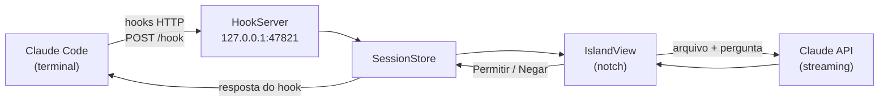

<div align="center">

# ✦ Ilha

**Um "dynamic island" no notch do MacBook para o Claude Code.**

Veja o que cada sessão está fazendo, aprove permissões sem sair do que você está fazendo
e pergunte ao Claude sobre qualquer arquivo arrastando ele pro notch.


</div>

---

## Sumário

- [O que ela faz](#-o-que-ela-faz)
- [Requisitos](#-requisitos)
- [Instalação](#-instalação)
- [Como usar](#-como-usar)
- [Menu ✦](#-menu-)
- [Chave da API](#-chave-da-api)
- [Como funciona](#-como-funciona)
- [Estrutura do projeto](#-estrutura-do-projeto)
- [Solução de problemas](#-solução-de-problemas)
- [Desinstalar](#-desinstalar)

---

## ✨ O que ela faz

| | Recurso | Descrição |
|---|---|---|
| 👀 | **Sessões ao vivo** | Mostra em tempo real o que cada sessão do Claude Code está fazendo (`Read billing.ts`, `Bash npm test`…). |
| 🔐 | **Permissões no notch** | Quando o Claude pede aprovação, a ilha expande com **Permitir**, **Negar** e **Ver no terminal**. |
| ✅ | **Aviso de conclusão** | Ao terminar, mostra um trecho da última mensagem por 4 s, com som opcional. |
| 📎 | **Arraste e pergunte** | Solte um PDF, imagem, texto ou `.docx` no notch, faça uma pergunta e receba a resposta em streaming. |
| ⚡ | **Comandos rápidos** | Abra apps, pastas e sites direto da ilha, sem precisar de chave da API. |
| 🫧 | **Mascote** | Um mascote próprio que muda de expressão: ocioso, trabalhando, esperando, concluído e "comendo" arquivos. |

A Ilha funciona em Macs **com ou sem notch**: sem notch, ela fica centralizada no topo da tela. Não aparece no Dock, só no ícone ✦ da barra de menus. Quando não há nenhuma sessão ativa, ela fica invisível.

---

## 📋 Requisitos

- macOS **13 Ventura** ou mais recente
- **Command Line Tools** da Apple (o Xcode completo não é necessário)
- [Claude Code](https://docs.anthropic.com/en/docs/claude-code) instalado
- *(Opcional)* uma chave da API da Anthropic, só para perguntar sobre arquivos

---

## 🚀 Instalação

```bash
# 1. Confira se o Swift está disponível (se falhar, instale as Command Line Tools)
swift --version || xcode-select --install

# 2. Clone e compile
git clone https://github.com/gabrueldev/ilha-dinamica-macbook.git
cd ilha-dinamica-macbook/Ilha
chmod +x build.sh && ./build.sh

# 3. (Recomendado) mova para Aplicativos e abra
mv build/Ilha.app /Applications/
open /Applications/Ilha.app
```

Na primeira vez que abrir, aceite **Instalar hooks do Claude Code**. Depois abra um **terminal novo** e rode `claude`: a ilha deve reagir.

> [!NOTE]
> Só sessões abertas **depois** de instalar os hooks reagem. Feche o `claude` e abra de novo (o `/clear` não basta).

O `build.sh` compila em modo release, monta o `Ilha.app` e aplica uma assinatura ad-hoc, suficiente para rodar localmente.

---

## 🖱 Como usar

### Sessões
Passe o mouse no notch para ver a lista de sessões. Clique numa delas para trazer o Terminal, o iTerm ou o VS Code correspondente para frente.

### Permissões
Quando o Claude Code pede permissão, a ilha expande sozinha:

| Ação | Atalho |
|---|---|
| Permitir | <kbd>⏎</kbd> |
| Negar | <kbd>⎋</kbd> |
| Ver no terminal | clique |

Se ninguém responder em cerca de **280 s**, a pergunta volta para o terminal normalmente.

### Perguntar sobre arquivos
Arraste um arquivo para o notch, digite a pergunta e a resposta chega em streaming dentro da ilha.

| Tipo | Formatos |
|---|---|
| Documentos | `pdf` |
| Imagens | `png` `jpg` `jpeg` `gif` `webp` |
| Texto rico | `doc` `docx` `rtf` `odt` `html` `htm` `webarchive` |
| Texto | arquivos de texto e código em geral |

Limite de **30 MB** por arquivo. Pastas não são aceitas.

### Comandos rápidos
No notch, clique em **Perguntar ao Claude…** e digite:

```text
abrir calculadora        → abre o app (aceita o nome em português)
abrir vscode             → abre o VS Code
abrir downloads          → abre a pasta no Finder
abrir ~/Projetos         → abre qualquer caminho
gabrueldev.com           → abre no Safari (com ou sem "abrir")
localhost:3000           → também funciona
```

---

## ✦ Menu ✦

| Item | O que faz |
|---|---|
| Status do servidor | Mostra se a porta `47821` está ativa |
| Instalar / Remover hooks | Liga ou desliga a integração com o Claude Code |
| Chave da API… | Salva a chave no Keychain |
| Modelo… | Troca o modelo usado nas perguntas (padrão: `claude-sonnet-5-5`) |
| Som ao terminar | Toca um som quando uma sessão termina |
| Abrir ao iniciar sessão | Abre a Ilha quando você faz login no Mac |
| Sair | Fecha o app (<kbd>⌘</kbd><kbd>Q</kbd>) |

> [!TIP]
> Antes de ativar **Abrir ao iniciar sessão**, mova o app para `/Applications`. Se você ativar a partir de `build/`, recompilar pode quebrar o atalho.

---

## 🔑 Chave da API

A chave **só é necessária para perguntar sobre arquivos**. Acompanhar sessões, aprovar permissões e usar os comandos rápidos não consome API.

1. Gere uma chave em [console.anthropic.com](https://console.anthropic.com).
2. Menu ✦ → **Chave da API…** → cole a chave.

A chave fica guardada no **Keychain do macOS** (serviço `app.ilha.notch`) e nunca é gravada em arquivo.

> [!IMPORTANT]
> O uso da API é **cobrado à parte** da assinatura do Claude (Pro/Max).

---

## ⚙️ Como funciona



1. Ao instalar, a Ilha adiciona hooks HTTP no `~/.claude/settings.json` apontando para `http://127.0.0.1:47821/hook`, sem mexer nos hooks que já existiam.
2. O Claude Code envia cada evento para o servidor local da Ilha, que atualiza o estado da sessão e a interface.
3. No caso do `PermissionRequest`, o servidor segura a conexão até você clicar e devolve a decisão para o Claude Code.
4. Se a Ilha estiver fechada, a conexão falha e o Claude Code segue normalmente. **Nada trava.**

### Eventos escutados

| Evento | Timeout | Uso |
|---|---|---|
| `SessionStart` | 5 s | Registra a sessão |
| `UserPromptSubmit` | 5 s | Marca a sessão como trabalhando |
| `PreToolUse` / `PostToolUse` | 5 s | Mostra a ferramenta em uso |
| `PermissionRequest` | 300 s | Pede aprovação na ilha |
| `Notification` | 5 s | Avisos do Claude Code |
| `Stop` | 5 s | Mostra a mensagem final |
| `SessionEnd` | 5 s | Remove a sessão |

### Teste manual

```bash
curl -s http://127.0.0.1:47821/health   # → ok

curl -s -X POST http://127.0.0.1:47821/hook -d '{
  "hook_event_name": "PreToolUse", "session_id": "t1",
  "cwd": "/Users/eu/projeto", "tool_name": "Bash",
  "tool_input": {"command": "npm test"}
}'

# Este fica esperando até você clicar na ilha:
curl -s -X POST http://127.0.0.1:47821/hook -d '{
  "hook_event_name": "PermissionRequest", "session_id": "t1",
  "cwd": "/Users/eu/projeto", "tool_name": "Bash",
  "tool_input": {"command": "git push origin main"}
}'
```

---

## 🗂 Estrutura do projeto

```
.
├── ILHA_SPEC.md              # especificação completa do app
└── Ilha/
    ├── Package.swift         # Swift Package, macOS 13+, sem dependências
    ├── Info.plist            # LSUIElement = sem ícone no Dock
    ├── build.sh              # compila e gera build/Ilha.app
    └── Sources/Ilha/
        ├── main.swift          # AppDelegate, menu ✦, painel e servidor
        ├── NotchPanel.swift    # janela sem borda, geometria do notch, passagem de cliques
        ├── NotchShape.swift    # formato da ilha
        ├── IslandView.swift    # interface: recolhida, expandida, permissão, concluído, arquivo
        ├── Mascot.swift        # mascote e suas expressões
        ├── SessionStore.swift  # estado das sessões e permissões pendentes
        ├── HookServer.swift    # servidor HTTP mínimo (Network.framework)
        ├── HookInstaller.swift # instala/remove os hooks no settings.json
        ├── ClaudeAPI.swift     # chamada em streaming à Messages API
        ├── FileLoader.swift    # converte arquivos em conteúdo para a API
        ├── Launcher.swift      # comandos rápidos (apps, pastas, sites)
        └── Keychain.swift      # guarda a chave da API
```

---

## 🩺 Solução de problemas

<details>
<summary><b>A ilha não reage às sessões</b></summary>

1. **A Ilha está aberta?** Procure o ✦ na barra de menus ou rode `curl -s http://127.0.0.1:47821/health` (deve responder `ok`).
2. **Os hooks estão instalados?** No menu ✦ deve aparecer "Hooks do Claude Code instalados" com ✓.
3. **A sessão é nova?** Feche o `claude` e abra de novo depois de instalar os hooks.

</details>

<details>
<summary><b>"Porta 47821 ocupada" no menu</b></summary>

Provavelmente há outra Ilha aberta. Rode `pkill -x Ilha` e abra de novo.

</details>

<details>
<summary><b><code>swift: command not found</code></b></summary>

Instale as Command Line Tools com `xcode-select --install` e abra um terminal novo.

</details>

<details>
<summary><b>"Abrir ao iniciar sessão" parou de funcionar</b></summary>

Isso acontece quando o atalho foi ativado a partir de `build/` e o app foi recompilado. Mova o app para `/Applications` e ative a opção de novo.

</details>

---

## 🧹 Desinstalar

1. Menu ✦ → **Remover hooks**. Só as entradas da Ilha saem do `~/.claude/settings.json`.
2. Feche a Ilha e apague o `Ilha.app`.

Um backup do `settings.json` original fica em `~/.claude/settings.json.ilha-backup`.

---

<div align="center">
<sub>Feito com Swift e SwiftUI por <a href="https://github.com/gabrueldev">@gabrueldev</a></sub>
</div>
